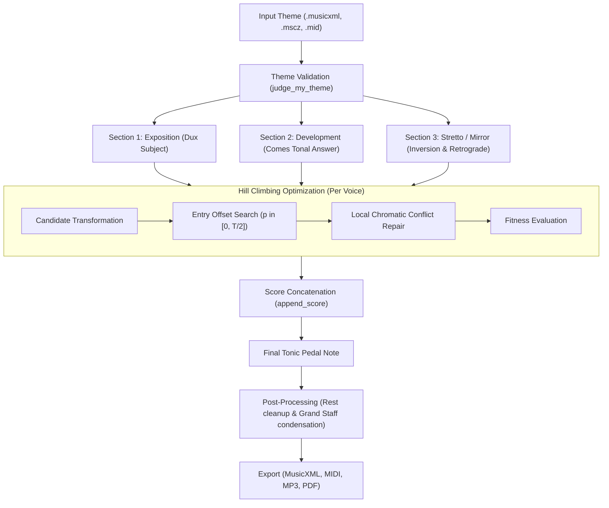

# Baroque Fugue Generator

Algorithmic polyphonic composition using Hill Climbing search and species counterpoint constraints.

## Overview and Design Objective

This project explores algorithmic composition of multi-voice Baroque counterpoint using heuristic optimization with Python and `music21`.

**Primary Goal:** The engine was designed with a specific optimization challenge in mind: **to maximize the total number of notes and rhythmic density** across multiple voices while strictly adhering to classical counterpoint rules (vertical consonance, avoidance of parallel fifths and octaves, and voice independence).

Because the fitness function heavily rewards dense polyphonic activity and layers transformations (dux, comes, inversion, retrograde) across up to 8 voices, **the original subject is deliberately submerged into a thick, continuous polyphonic web** rather than standing out as a clear, exposed solo melody. The output is structured for pipe organ in condensed grand staff notation.

---

## Sample Output

Below is an excerpt of a generated 4-voice fugue based on Bart Howard's *"Fly Me to the Moon"*, synthesized and formatted for pipe organ:


### Pre-Generated Files
- Audio recording (MP3): [`samples/fly_me_to_the_moon_fugue.mp3`](samples/fly_me_to_the_moon_fugue.mp3)
- MIDI file: [`samples/fly_me_to_the_moon_fugue.mid`](samples/fly_me_to_the_moon_fugue.mid)
- Sheet music (PDF): [`samples/fly_me_to_the_moon_fugue.pdf`](samples/fly_me_to_the_moon_fugue.pdf)
- Full score (MusicXML): [`samples/fly_me_to_the_moon_fugue.musicxml`](samples/fly_me_to_the_moon_fugue.musicxml)

---

## Architecture and Pipeline

The engine takes a monophonic theme, validates its structure, and synthesizes three sequential fugal sections before applying post-processing for organ performance:



---

## Musicological and Algorithmic Rules

### 1. Subject Requirements (`judge_my_theme`)
Before generating counter-melodies, the input subject is checked against classical rules:
- **Tonal Entry:** The subject must begin on either the tonic (scale degree 1) or dominant (scale degree 5).
- **Meter:** Set to 4/4 common time.
- **Length:** Bounded between 2.0 and 5.0 measures (8 to 20 quarter beats).
- **Range:** Melodic compass must not exceed one octave (12 semitones).

### 2. Contrapuntal Transformations
Candidate voices are constructed using standard compositional operations from 18th-century counterpoint:
- **Dux (Subject):** The primary thematic statement.
- **Comes (Tonal Answer):** Transposed to the dominant (+7 or -5 semitones), with interval adjustment applied to early melodic leaps to maintain key stability.
- **Inversion:** Mirror motion where ascending intervals become descending intervals of equal size.
- **Retrograde (Cancrizans):** The theme played strictly in reverse order.
- **Augmentation and Diminution:** Metric tempo scaling (half speed / double speed).
- **Diatonic Harmony Shift:** Stepwise transposition along scale degrees of the analyzed key.

### 3. Hill Climbing Search and Objective Function
Voices are added sequentially. For each new voice layer, candidate transformations are generated and evaluated across all valid entry offsets $p$.

The fitness function scores three distinct musical properties:

$$\text{Fitness}(S) = \sum_{c \in \text{Chords}(S)} \left[ 20 \cdot V_c^2 \cdot d_c + \sum_{(p_i, p_j)} \text{Consonance}(p_i, p_j) \cdot d_c \right] + 500 \cdot \overline{\text{Divergence}}$$

- **Density & Voice Count ($20 \cdot V_c^2 \cdot d_c$):** Strong non-linear incentive to keep as many distinct voices active simultaneously as possible, driving the maximal note density.
- **Harmonic Consonance:**
  - Major/minor thirds and sixths: $+15 \cdot d_c$
  - Perfect fifths and octaves: $+5 \cdot d_c$
  - Dissonances (unisons, seconds, sevenths, tritones): $-100 \cdot d_c$
- **Voice Independence ($500 \cdot \overline{\text{Divergence}}$):** Compares pitch intervals and rhythmic contours between voices to penalize identical or parallel motion.

### 4. Conflict Resolution
When a candidate voice is placed at an offset, any direct vertical collisions that produce harsh dissonances (minor/major seconds, tritones, unisons) are dynamically repaired: the note is shifted by the smallest chromatic interval ($\pm 1 \dots \pm 12$ semitones) that restores vertical consonance with existing voices.

---

## Quickstart

### Requirements
- Python 3.10+
- `music21` library
- *(Optional)* MuseScore 3 (only needed if using `.mscz` files directly or exporting MP3/PDF)

### Setup
```bash
git clone git@github.com:StrachNaWroble/Fuga_barokowa.git
cd Fuga_barokowa
pip install -r requirements.txt
```

### Running the Generator
Run with default settings (uses included sample theme, 4 voices):
```bash
python ofuga.py
```
Or use the convenience runner:
```bash
python generate_fugue.py
```

### CLI Options
```bash
python ofuga.py \
  --input examples/fly_me_to_the_moon.musicxml \
  --output output/my_fugue.musicxml \
  --voices 4 \
  --iterations 8 \
  --seed 42 \
  --export-midi \
  --export-mp3 \
  --export-pdf
```

| Option | Type | Default | Description |
|---|---|---|---|
| `-i`, `--input` | `str` | `examples/fly_me_to_the_moon.musicxml` | Input score path (`.musicxml`, `.mscz`, `.mid`) |
| `-o`, `--output` | `str` | `output/fugue.musicxml` | Destination MusicXML path |
| `-v`, `--voices` | `int` | `4` | Polyphonic voices per section |
| `-n`, `--iterations` | `int` | `8` | Candidates evaluated per voice layer |
| `-s`, `--seed` | `int` | `None` | Random seed for deterministic generation |
| `--export-midi` | flag | `False` | Also export `.mid` MIDI audio |
| `--export-mp3` | flag | `False` | Export `.mp3` audio (requires MuseScore) |
| `--export-pdf` | flag | `False` | Export `.pdf` score (requires MuseScore) |

---

## Tests

Run the test suite using Python's built-in `unittest`:
```bash
python -m unittest discover -s tests -v
```

Tests cover subject validation constraints, inversion and retrograde correctness, consonance scoring preferences, and score cleanup.

---

## Repository Structure

```
Fuga_barokowa/
├── README.md                 # Project documentation
├── requirements.txt          # Python dependencies
├── .gitignore                # Git exclusions
├── ofuga.py                  # Main fugue generator and CLI
├── generate_fugue.py         # Convenience runner alias
├── music_lib.py              # Music library, scoring, and score cleaner
├── assets/
│   └── score_preview.png     # Rendered organ score preview
├── examples/                 # Sample input themes
│   ├── fly_me_to_the_moon.musicxml
│   ├── fly_me_to_the_moon.mscz
│   ├── bach_art_of_fugue.musicxml
│   ├── bach_art_of_fugue.mid
│   └── wlazl_kotek.musicxml
├── samples/                  # Pre-generated outputs
│   ├── fly_me_to_the_moon_fugue.musicxml
│   ├── fly_me_to_the_moon_fugue.mid
│   ├── fly_me_to_the_moon_fugue.mp3
│   └── fly_me_to_the_moon_fugue.pdf
└── tests/
    └── test_counterpoint.py  # Unit test suite
```

---

## Author

**Justyna Rojek-Nowosielska**  
University of Wrocław (Computer Science & Art History)  
GitHub: [@StrachNaWroble](https://github.com/StrachNaWroble)
