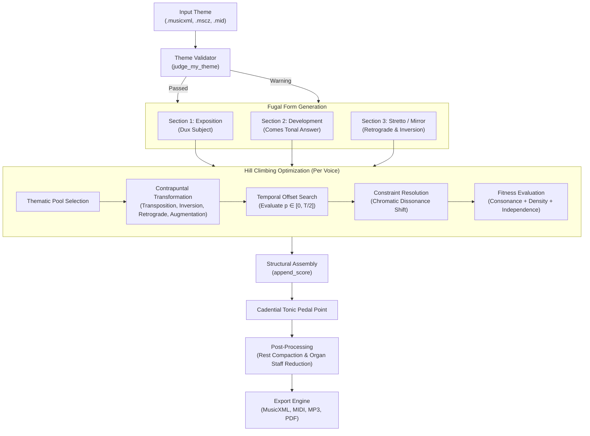

# Baroque Fugue Generator (Fuga Barokowa)

[](https://www.python.org/downloads/)
[](https://web.mit.edu/music21/)
[]()
[](LICENSE)

An algorithmic composition engine that synthesizes multi-voice Baroque fugues from monophonic themes using **heuristic search (Hill Climbing)**, **species counterpoint constraints**, and **computational musicology (`music21`)**.

The engine transforms an initial melodic subject into an authentic, multi-section polyphonic work for pipe organ, balancing strict 18th-century harmonic rules (consonance, resolution of parallel intervals, voice leading) with melodic independence across up to 8 voices.

---

## 🎼 Sample Output Showcase

Below is an excerpt of a generated 4-voice fugue based on Bart Howard's *"Fly Me to the Moon"*, synthesized and formatted for pipe organ grand staff notation:


### Listen & Inspect Pre-Generated Scores:
- 🔊 **Audio Recording (MP3):** [`samples/fly_me_to_the_moon_fugue.mp3`](samples/fly_me_to_the_moon_fugue.mp3)
- 🎹 **MIDI File:** [`samples/fly_me_to_the_moon_fugue.mid`](samples/fly_me_to_the_moon_fugue.mid)
- 📄 **Sheet Music (PDF):** [`samples/fly_me_to_the_moon_fugue.pdf`](samples/fly_me_to_the_moon_fugue.pdf)
- 🎼 **Full MusicXML Score:** [`samples/fly_me_to_the_moon_fugue.musicxml`](samples/fly_me_to_the_moon_fugue.musicxml)

---

## 🏛️ System Architecture

The composition pipeline processes a monophonic theme through three formal contrapuntal sections, assembling voices sequentially using heuristic search and constraint resolution:



---

## 🧠 Algorithmic & Musicological Foundation

### 1. Subject Validation (`judge_my_theme`)
Before polyphonic synthesis, the candidate theme is verified against classical fugue subject criteria:
- **Tonal Entry:** The initial note must land on the **tonic** (degree 1) or **dominant** (degree 5) of the analyzed key.
- **Metric Regularity:** Fixed to common time ($4/4$).
- **Formal Proportion:** Theme duration restricted between 2.0 and 5.0 measures (8 to 20 beats).
- **Vocal Compass:** Total pitch range must not exceed one octave ($\le 12$ semitones) to ensure singable and contrapuntally viable lines.

### 2. Classical Contrapuntal Transformations
The algorithm generates candidate counter-melodies by drawing from canonical Baroque operations:
- **Dux (Subject):** The original theme in its primary form.
- **Comes (Tonal Answer):** Transposed to the dominant ($+7$ or $-5$ semitones), with tonal interval muting applied to the initial leap to preserve tonal stability.
- **Inversion (Mirror Counterpoint):** Melodic intervals reflected about the horizontal axis ($\Delta p' = -\Delta p$).
- **Retrograde (Cancrizans / Crab Canon):** Temporal reversal of the note sequence.
- **Augmentation & Diminution:** Rhythmic scaling by factors of $2.0$ (half tempo) and $0.5$ (double tempo).
- **Diatonic Shift:** Shifting melody degrees by diatonic scale steps within the extracted key signature.

### 3. Heuristic Search (Hill Climbing)
To construct an $N$-voice texture, voices are added iteratively. For each new voice layer:
1. $n$ candidate transformations are generated stochastically.
2. For each candidate, all valid entry delays $p \in [0, \lfloor T / 2 \rfloor]$ are tested.
3. Clashing dissonances are repaired via minimal chromatic shifts.
4. The candidate with the highest global fitness score is accepted into the polyphonic score.

### 4. Objective Fitness Function
The scoring function evaluates vertical harmonic quality, active texture density, and voice independence:

$$\text{Fitness}(S) = \sum_{c \in \text{Chords}(S)} \left[ 20 \cdot V_c^2 \cdot d_c + \sum_{(p_i, p_j)} \text{IntervalScore}(p_i, p_j) \cdot d_c \right] + 500 \cdot \overline{\text{Divergence}}$$

Where:
- $V_c$ is the number of active distinct pitch classes in vertical slice $c$.
- $d_c$ is the duration (in quarter notes) of vertical slice $c$.
- **Interval Scoring:**
  - **Imperfect Consonances (Major/Minor 3rds & 6ths):** $+15 \cdot d_c$ (core harmonic foundation).
  - **Perfect Consonances (5ths, Octaves):** $+5 \cdot d_c$.
  - **Harsh Dissonances & Unison Collisions (2nds, 7ths, Tritones, 0 semitones):** $-100 \cdot d_c$.
- **Voice Divergence ($\overline{\text{Divergence}}$):** Rewards melodic and rhythmic independence between voice pairs, preventing parallel movement or voice duplication.

### 5. Constraint Resolution & Voice Leading
When a candidate voice is placed at offset $p$, local note collisions are handled dynamically:
- Unisons ($0$ st), minor/major seconds ($1, 2$ st), tritones ($6$ st), and minor/major sevenths ($10, 11$ st) trigger a chromatic neighborhood search.
- The colliding note is shifted by the minimal semitone displacement ($\pm 1 \dots \pm 12$) that converts the vertical clash into a consonant interval.

---

## 🚀 Quickstart

### Prerequisites
- Python 3.10 or higher.
- *(Optional)* [MuseScore 3](https://musescore.org/) (for converting `.mscz` files and rendering MP3/PDF directly).

### Installation
```bash
# Clone the repository
git clone git@github.com:StrachNaWroble/Fuga_barokowa.git
cd Fuga_barokowa

# Install Python dependencies
pip install -r requirements.txt
```

### Basic Usage
Generate a 4-voice fugue from the included sample theme:
```bash
python ofuga.py
```
This produces `output/fugue.musicxml` by default.

### Advanced CLI Options
```bash
python ofuga.py \
  --input examples/fly_me_to_the_moon.musicxml \
  --output output/my_fugue.musicxml \
  --voices 4 \
  --iterations 8 \
  --seed 42 \
  --export-midi \
  --export-mp3 \
  --export-pdf
```

| Argument | Type | Default | Description |
|---|---|---|---|
| `-i`, `--input` | `str` | `examples/fly_me_to_the_moon.musicxml` | Input score path (`.musicxml`, `.mscz`, or `.mid`) |
| `-o`, `--output` | `str` | `output/fugue.musicxml` | Destination MusicXML path |
| `-v`, `--voices` | `int` | `4` | Number of polyphonic voices per section |
| `-n`, `--iterations` | `int` | `8` | Number of candidate transformations evaluated per voice layer |
| `-s`, `--seed` | `int` | `None` | Random seed for deterministic generation |
| `--export-midi` | flag | `False` | Also export `.mid` MIDI audio |
| `--export-mp3` | flag | `False` | Also render `.mp3` audio *(requires MuseScore)* |
| `--export-pdf` | flag | `False` | Also render `.pdf` score sheet *(requires MuseScore)* |

---

## 🧪 Testing

The repository contains automated unit and integration tests covering musical transformations, constraint validation, and fitness monotonicity:

```bash
python -m unittest discover -s tests -v
```

Expected output:
```text
test_answer_generation ... ok
test_clean_score_rest_merging ... ok
test_harmonic_evaluation_consonance_vs_dissonance ... ok
test_inversion_direction ... ok
test_retrograde_reversal ... ok
test_run_hill_climbing_smoke ... ok
test_theme_validation_exceeding_octave ... ok
test_theme_validation_invalid_meter ... ok
test_theme_validation_valid ... ok

Ran 9 tests in 0.17s - OK
```

---

## 📁 Repository Structure

```
Fuga_barokowa/
├── README.md                 # Project documentation & analysis
├── requirements.txt          # Python dependencies (music21)
├── LICENSE                   # MIT License
├── .gitignore                # Git exclusions
├── ofuga.py                  # Main fugue generator & CLI interface
├── generate_fugue.py         # Convenience runner alias
├── music_lib.py              # Musical operations, scoring, & score cleaner
├── assets/                   # Visual previews and diagram assets
│   └── score_preview.png     # Rendered organ score preview
├── examples/                 # Ready-to-use input themes
│   ├── fly_me_to_the_moon.musicxml
│   ├── fly_me_to_the_moon.mscz
│   ├── bach_art_of_fugue.musicxml
│   ├── bach_art_of_fugue.mid
│   └── wlazl_kotek.musicxml
├── samples/                  # Pre-generated outputs
│   ├── fly_me_to_the_moon_fugue.musicxml
│   ├── fly_me_to_the_moon_fugue.mid
│   ├── fly_me_to_the_moon_fugue.mp3
│   └── fly_me_to_the_moon_fugue.pdf
└── tests/                    # Automated test suite
    └── test_counterpoint.py  # Unit tests for transformations & fitness
```

---

## 💡 Engineering Highlights for Recruiters

- **Domain-Informed Heuristic Optimization:** Instead of treating music generation as an unconstrained search or black-box model, the system encodes 18th-century counterpoint rules (Fux, Bach) directly into the objective function and constraint propagation pipeline.
- **Fast Convergence:** While early experiments with genetic algorithms required high generation counts with frequent harmonic collapse, Hill Climbing with targeted chromatic repair converges cleanly in seconds while preserving voice leading rules.
- **Polyphonic Score Formatting:** Raw polyphonic lines are automatically condensed into 2-voice keyboard staves (Pipe Organ Treble/Bass), with overlapping rests removed and consecutive rests merged into standard notation.
- **Robust Multi-Format Ingestion:** Seamlessly handles `.musicxml`, `.mid`, and `.mscz` files with automated fallback if external converters are unavailable.

---

## 👩‍💻 Author

**Justyna Rojek-Nowosielska**  
- B.Sc. in Computer Science & B.A. in Art History — *University of Wrocław*
- GitHub: [@StrachNaWroble](https://github.com/StrachNaWroble)
- 3-times Semi-finalist at the Polish Olympiad in Informatics (OI)

---

## 📄 License

This project is licensed under the [MIT License](LICENSE).
